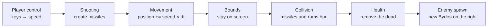

# R-Type — Gameplay (developer guide)

The gameplay is everything that makes R-Type a game: ships that move and shoot, Bydos that spawn and fire back, missiles that hit, ships that die. It is written on top of the project's ECS and lives in `shared/`, because the **server** is the one that runs it (it has the final say on what happens), and the client may reuse it later for prediction.

This page explains how it is organised and how to extend it. To learn the ECS itself (`Registry`, `SystemManager`), read the engine documentation first; the fixed-timestep loop is described in [gameLoop.md](gameLoop.md).

## The idea in 30 seconds

- An **entity** is just a number: the player ship, a Bydos, a missile.
- A **component** is plain data attached to an entity: a position, a speed, some health.
- A **system** is a function that runs every step on all the entities that have some components.

A missile is not a class: it is an entity with `Position`, `Velocity`, `Hitbox`, `Damage`, `Projectile` and `Kind`. A new kind of object is a new combination of components; existing systems keep working on it.

## One game step

Every step (60 per second), the systems run in this order:



The order matters: speed is computed before moving, entities move before collisions are tested, and the dead are removed after collisions. It is defined in one single place, `addGameplaySystems()`.

## Files

| Folder | Content |
|---|---|
| `project/include/shared/Components/` | The components (plain data, header only) |
| `project/include/shared/Systems/` and `project/src/shared/Systems/` | One system per file: declaration in the `.hpp`, code in the `.cpp` |
| `project/include/shared/Game/` and `project/src/shared/Game/` | `GameConfig.hpp` (all the tuning values), `Spawner` (create entities), `Gameplay` (register all systems) |

Everything is in the `r_type::game` namespace. Following the project conventions, files are included by name (`#include "Spawner.hpp"`), the folders are declared in CMake, each `.cpp` includes only its own header, and the gameplay never includes Raylib or Asio.

## Components

| Component | Data | Player | Bydos | Missile |
|---|---|:---:|:---:|:---:|
| `Position` | `x`, `y` (pixels, top-left corner) | ✔ | ✔ | ✔ |
| `Velocity` | `x`, `y` (pixels per second) | ✔ | ✔ | ✔ |
| `Hitbox` | `width`, `height` (collision rectangle) | ✔ | ✔ | ✔ |
| `Health` | `current`, `max` | ✔ | ✔ | |
| `Damage` | `amount` dealt to what it hits | | ✔ (ramming) | ✔ |
| `Weapon` | `fireRate`, `cooldown`, `projectileSpeed`, `damage` | ✔ | ✔ | |
| `Input` | `up`, `down`, `left`, `right`, `shoot` | ✔ | | |
| `Player` | `id` (1 to 4, gives the colour) | ✔ | | |
| `Enemy` | tag, no data | | ✔ | |
| `Projectile` | `fromPlayer` (which side it belongs to) | | | ✔ |
| `Kind` | `EntityKind`: what it is, to pick the sprite | ✔ | ✔ | ✔ |

## Systems

| System | What it does |
|---|---|
| `playerControlSystem` | Turns the `Input` of each player into a `Velocity` |
| `shootingSystem` | Counts down each `Weapon`'s cooldown. Players fire while `shoot` is held, Bydos fire as soon as their weapon is ready. Missiles are created **after** the loop |
| `movementSystem` | `position += velocity × dt` for everything that moves |
| `boundsSystem` | Keeps players inside the 1280 × 720 world, removes anything else that left it by more than 100 px |
| `collisionSystem` | Rectangle overlap test (AABB). A player missile hurts Bydos, a Bydos missile hurts players, a Bydos that touches a player hurts it. A missile or a ramming Bydos is used up by its first hit |
| `healthSystem` | Removes every entity whose health reached 0 |
| `EnemySpawnSystem` | Every 1.2 s, spawns a Bydos on the right edge at a random height. It is a class (a functor) because it keeps a timer and a random generator between steps; its seed is a parameter, so the same seed replays the same waves |

## Creating entities

Never build a ship by hand: use the `Spawner`, so that every ship has the same components.

```cpp
registerGameplayComponents(registry);            // once, on a new Registry

spawnPlayer(registry, 1, 100.f, 300.f);           // player #1 at (100, 300)
spawnEnemy(registry, 1280.f, 200.f, 0.5f);        // Bydos, first shot after 0.5 s
spawnMissile(registry, x, y, 700.f, 1, true);     // player missile going right
```

## Inputs

Clients send one `PLAYER_INPUT` per action (see [RFC](RFC/Protocol.md)). The server turns it into the player's `Input` component with `applyAction()`:

| Action | Code | Field set in `Input` |
|---|---|---|
| Up | `0x00` | `up` |
| Down | `0x01` | `down` |
| Left | `0x02` | `left` |
| Right | `0x03` | `right` |
| Fire | `0x04` | `shoot` |

```cpp
applyAction(registry.get<Input>(player), action, state == InputState::Pressed);
```

An action stays active until its release arrives, so the ship moves smoothly with time instead of once per packet.

## Running the gameplay

The game runs on the server, in the room's thread, with a fixed timestep:

```cpp
ecs::Registry registry;
ecs::SystemManager systems;
registerGameplayComponents(registry);
addGameplaySystems(systems, seed);

// every step
//   1. apply the received inputs with applyAction()
//   2. systems.run(registry, dt);
//   3. tell the clients what was created, moved or destroyed
```

After each step, the server compares the entities with what the clients already know: a new entity is sent with `ENTITY_SPAWN`, a missing one with `ENTITY_DESTROY`, and positions with `ENTITY_UPDATE` (20 times per second).

**Status:** the gameplay is compiled into the server, but the room does not call it yet; it still uses its own movement and shooting code. Plugging it in is issue #72.

## Entity kinds on the network

`EntityKind` describes what an entity is inside the game. The protocol uses its own `entity_kind` values, so the server converts them before sending `ENTITY_SPAWN`:

| `EntityKind` | Value in the game | `entity_kind` on the network |
|---|---|---|
| `Player` | 0 | `0x01` player ship |
| `Enemy` | 1 | `0x02` enemy |
| `PlayerMissile` | 2 | `0x03` projectile |
| `EnemyMissile` | 3 | `0x03` projectile |

## Tuning

All the numbers are in `GameConfig.hpp`, as `constexpr` constants: change one value, rebuild, done.

| Constant | Value | Meaning |
|---|---|---|
| `kWorldWidth`, `kWorldHeight` | 1280, 720 | Size of the world, in pixels |
| `kPlayerSpeed` | 320 | Player speed (px/s) |
| `kPlayerHealth` | 3 | Hits a player can take |
| `kPlayerFireRate` | 6 | Player shots per second |
| `kPlayerMissileSpeed` | 700 | Player missile speed (px/s) |
| `kEnemySpeed` | 160 | Bydos speed (px/s) |
| `kEnemyHealth` | 2 | Hits a Bydos can take |
| `kEnemySpawnInterval` | 1.2 | Seconds between two Bydos |
| `kEnemyFireRate` | 0.5 | Bydos shots per second |
| `kEnemyMissileSpeed` | 320 | Bydos missile speed (px/s) |
| `kDespawnMargin` | 100 | How far outside the world an entity can go before it is removed |

## How to add a new enemy

Say we want a fast, fragile Bydos that does not shoot.

1. Add a creation function to `Spawner.hpp` / `Spawner.cpp`, reusing the existing components:

```cpp
ecs::Entity spawnFastEnemy(ecs::Registry &r, float x, float y)
{
    const ecs::Entity e = r.spawn();
    r.add<Position>(e, Position{x, y});
    r.add<Velocity>(e, Velocity{-400.f, 0.f});
    r.add<Hitbox>(e, Hitbox{24.f, 24.f});
    r.add<Health>(e, Health{1, 1});
    r.add<Damage>(e, Damage{1});
    r.add<Enemy>(e);
    r.add<Kind>(e, Kind{EntityKind::Enemy});
    return e;
}
```

2. Call it from a spawn system. That's all: movement, bounds, collisions and death already work, because they only look at components. No `Weapon` means it never shoots.

## How to add a new system

1. Declare it in `project/include/shared/Systems/MySystem.hpp`, with all its includes:
   `void mySystem(ecs::Registry &r, float dt);`
2. Write it in `project/src/shared/Systems/MySystem.cpp`, which only includes `"MySystem.hpp"`.
3. Register it in `addGameplaySystems()` at the right place in the order.
4. Add any new component to `registerGameplayComponents()`.

No CMake change is needed: every `.cpp` in `project/src/shared/` is built automatically.

## Rules to respect

- **Use `dt` for everything that depends on time.** The game must run at the same speed on every machine; never count frames or packets.
- **Do not create or destroy entities while iterating.** Collect them in a `std::vector` during `each()`, then create or kill them after the loop (see `healthSystem` and `shootingSystem`).
- **Keep components as plain data.** If a component needs a method, a system is probably missing.
- **No Raylib, no Asio** in the gameplay: it must compile for the server, which has no window.

## Design choices

| Choice | Alternative | Why |
|---|---|---|
| ECS components and systems | Class hierarchy (`Ship`, `Player : Ship`…) | New objects are new combinations of components, without duplicating code. Logic stays decoupled from rendering and networking, as the subject requires. |
| AABB rectangles for collisions | Circles, pixel-perfect | Four comparisons per pair, enough for a shoot'em up. Pixel-perfect is much slower for no visible gain. Testing every pair is fine for a few hundred entities; a spatial grid would be the next step. |
| Collect, then create or kill | Modify entities during the loop | Changing the set of entities while iterating it is a classic source of bugs. |
| `EnemySpawnSystem` as a functor with a seed | A free function with global state | It keeps its own timer and random generator; the same seed replays the same game, which helps testing. |
| `constexpr` tuning values in one file | `#define`, values spread in the code | Typed, scoped in the namespace, free at run time, and all in one place. |

## Next steps

The next issues turn this into a content creation tool for game designers (Track 3):

- #76 describe a level in a file
- #77 define enemy types in a file
- #78 reusable movement patterns
- #79 scripted waves
