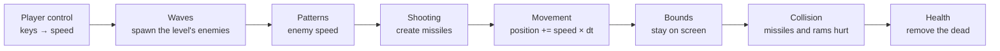

# R-Type — Gameplay (developer guide)

The gameplay is everything that makes R-Type a game: ships that move and shoot, Bydos that spawn and fire back, missiles that hit, ships that die. It is written on top of the project's ECS and lives in `shared/`, because the **server** is the one that runs it (it has the final say on what happens), and the client may reuse it later for prediction.

This page explains how it is organised and how to extend it. To learn the ECS itself (`Registry`, `SystemManager`), read the engine documentation first; the fixed-timestep loop is described in [gameLoop.md](gameLoop.md).

## The idea in 30 seconds

- An **entity** is just a number: the player ship, a Bydos, a missile.
- A **component** is plain data attached to an entity: a position, a speed, some health.
- A **system** is a function that runs every step on all the entities that have some components.

A missile is not a class: it is an entity with `Position`, `Velocity`, `Hitbox`, `Damage`, `Projectile` and `Kind`. A new kind of object is a new combination of components; existing systems keep working on it.

## One game step

Every step (60 per second), the systems run in this order:



The order matters: speed is computed before moving, entities move before collisions are tested, and the dead are removed after collisions. It is defined in one single place, `addGameplaySystems()`.

## Files

| Folder | Content |
|---|---|
| `project/include/shared/Components/` | The components (plain data, header only) |
| `project/include/shared/Systems/` and `project/src/shared/Systems/` | One system per file: declaration in the `.hpp`, code in the `.cpp` |
| `project/include/shared/Game/` and `project/src/shared/Game/` | `GameConfig.hpp` (all the tuning values), `Spawner` (create entities), `Level` (read a level file), `Gameplay` (register all systems) |
| `assets/levels/` | One JSON file per level |

Everything is in the `r_type::game` namespace. Following the project conventions, files are included by name (`#include "Spawner.hpp"`), the folders are declared in CMake, each `.cpp` includes only its own header, and the gameplay never includes Raylib or Asio.

## Components

| Component | Data | Player | Enemy | Missile |
|---|---|:---:|:---:|:---:|
| `Position` | `x`, `y` (pixels, top-left corner) | ✔ | ✔ | ✔ |
| `Velocity` | `x`, `y` (pixels per second) | ✔ | ✔ | ✔ |
| `Hitbox` | `width`, `height` (collision rectangle) | ✔ | ✔ | ✔ |
| `Health` | `current`, `max` | ✔ | ✔ | |
| `Damage` | `amount` dealt to what it hits | | ✔ (ramming) | ✔ |
| `Weapon` | `fireRate`, `cooldown`, `projectileSpeed`, `damage` | ✔ | ✔ | |
| `Input` | `up`, `down`, `left`, `right`, `shoot` | ✔ | | |
| `Player` | `id` (1 to 4): the character + 1 (1 Ana, 2 Soha, 3 Hilal, 4 Eric) | ✔ | | |
| `Enemy` | `type` (`EnemyType`: simit, chat...) | | ✔ | |
| `Pattern` | `type` (`PatternType`), `speed`, `baseY`, `age`, `direction`: how the enemy moves | | ✔ | |
| `Boss` | tag, no data | | boss only | |
| `Projectile` | `fromPlayer` (which side it belongs to) | | | ✔ |
| `Kind` | `EntityKind`: what it is, to pick the sprite | ✔ | ✔ | ✔ |

## Systems

| System | What it does |
|---|---|
| `playerControlSystem` | Turns the `Input` of each player into a `Velocity` |
| `WaveSystem` | Spawns the enemies of the level at the times written in its file, then the boss at `boss.time`. The level starts again 10 s after the boss died (or after the last enemy if the level has no boss). It is a class (a functor) because it keeps the level, a clock and a random generator; its seed is a parameter, so the same seed replays the same game |
| `patternSystem` | Sets the `Velocity` of each enemy from its `Pattern` (see *Patterns*) |
| `shootingSystem` | Counts down each `Weapon`'s cooldown. Players fire while `shoot` is held, enemies fire as soon as their weapon is ready (an enemy with `fireRate` 0 never shoots). A boss fires two missiles, from its top and bottom cannons, so the middle of the boss is the safe place to shoot it from. Missiles are created **after** the loop |
| `movementSystem` | `position += velocity × dt` for everything that moves |
| `boundsSystem` | Keeps players inside the 1280 × 720 world, removes anything else that left it by more than 100 px |
| `collisionSystem` | Rectangle overlap test (AABB). A player missile hurts enemies, an enemy missile hurts players, an enemy that touches a player hurts it. A missile or a ramming enemy is used up by its first hit, except a boss |
| `healthSystem` | Removes every entity whose health reached 0 |

## Creating entities

Never build a ship by hand: use the `Spawner`, so that every ship has the same components.

```cpp
registerGameplayComponents(registry);            // once, on a new Registry

spawnPlayer(registry, 1, 100.f, 300.f);           // player #1 at (100, 300)
spawnEnemy(registry, EnemyType::Cay, PatternType::Sine, 1280.f, 200.f, 0.5f);   // a çay, first shot after 0.5 s
spawnMissile(registry, x, y, 700.f, 1, true);     // player missile going right
```

## Inputs

Clients send one `PLAYER_INPUT` per action (see [RFC](RFC/Protocol.md)). The server turns it into the player's `Input` component with `applyAction()`:

| Action | Code | Field set in `Input` |
|---|---|---|
| Up | `0x00` | `up` |
| Down | `0x01` | `down` |
| Left | `0x02` | `left` |
| Right | `0x03` | `right` |
| Fire | `0x04` | `shoot` |

```cpp
applyAction(registry.get<Input>(player), action, state == InputState::Pressed);
```

An action stays active until its release arrives, so the ship moves smoothly with time instead of once per packet.

## Running the gameplay

The game runs on the server, in the room's thread, with a fixed timestep:

```cpp
ecs::Registry registry;
ecs::SystemManager systems;
registerGameplayComponents(registry);
addGameplaySystems(systems, seed, loadLevel("assets/levels/turquie.json"));

// every step
//   1. apply the received inputs with applyAction()
//   2. systems.run(registry, dt);
//   3. tell the clients what was created, moved or destroyed
```

After each step, the server compares the entities with what the clients already know: a new entity is sent with `ENTITY_SPAWN`, a missing one with `ENTITY_DESTROY`, and positions with `ENTITY_UPDATE` (20 times per second).

A new room plays no level: players can move and shoot, but no enemy comes. The client that created the room sends `CHOOSE_LEVEL`; the room then loads `assets/levels/<country>.json` (`levelPath()`, the names are in `kLevelNames`), rebuilds its systems with `addGameplaySystems()`, and tells every client with `LEVEL_START`. If the file cannot be read, the room logs the error and keeps waiting.

## Entity kinds on the network

`EntityKind` describes what an entity is inside the game. The protocol uses its own `entity_kind` values, so the server converts them before sending `ENTITY_SPAWN`:

| `EntityKind` | Value in the game | `entity_kind` on the network |
|---|---|---|
| `Player` | 0 | `0x01` player ship |
| `Enemy` | 1 | `0x02` enemy |
| `PlayerMissile` | 2 | `0x03` projectile |
| `EnemyMissile` | 3 | `0x03` projectile |

The last field of `ENTITY_SPAWN` (`color`) tells the client which sprite to draw: the character for a player, the `EnemyType` for an enemy (`10` to `13` for the bosses), and `0` (player missile) or `1` (enemy missile) for a projectile.

## Levels

A level is a JSON file in `assets/levels/`. `loadLevel()` reads it into a `LevelData`, and the `WaveSystem` plays it.

```json
{
    "name": "Istanbul",
    "country": "turquie",
    "owner": "Hilal",
    "background": "turquie",
    "waves": [
        { "time": 1, "enemy": "simit", "pattern": "sine",     "count": 6, "spacing": 0.5 },
        { "time": 7, "enemy": "cay",   "pattern": "straight", "count": 5, "spacing": 0.7 }
    ],
    "boss": { "type": "doner", "health": 60, "time": 40 }
}
```

| Field | Meaning |
|---|---|
| `time` | Seconds from the start of the level |
| `count`, `spacing` | How many enemies, and seconds between two of them |
| `enemy` | `ballon`, `supporter`, `defenseur`, `scorpion`, `harissa`, `simit`, `cay`, `chat`, `grognard`, `sanglier` |
| `pattern` | See below; `straight` if missing |
| `boss` | `type` (`eldiez`, `couscoussier`, `doner`, `napoleon`), `health`, and `time` (seconds from the start) |

An unknown enemy or pattern, or a negative time, count or spacing, makes `loadLevel()` throw an `Error` that names the problem.

| Enemy | Health | Speed (px/s) | Shoots every |
|---|---|---|---|
| `ballon` | 1 | 170 | never |
| `supporter` | 2 | 120 | 2.6 s |
| `defenseur` | 4 | 70 | never |
| `scorpion` | 2 | 140 | 3 s |
| `harissa` | 1 | 130 | never |
| `simit` | 1 | 180 | never |
| `cay` | 2 | 120 | 2.6 s |
| `chat` | 1 | 210 | never |
| `grognard` | 2 | 70 | 3.4 s |
| `sanglier` | 3 | 200 | never |

### Patterns

| Pattern | Movement |
|---|---|
| `straight` | Straight to the left |
| `sine` | Waves up and down (55 px) |
| `zigzag` | Goes up and down 70 px around its start height |
| `bounce` | Bounces between the top and the bottom of the screen |
| `dive` | Moves towards the closest player while it is still in front of them |
| `wall` | All the enemies of the wave line up and stop at 62 % of the screen for 9 s |
| `formation` | Lines of up to 5 enemies that advance by jerks |

### Bosses

At `boss.time`, the boss (160 × 160) comes in from the right, stops 40 px from the edge, and goes up and down slowly while firing. It has the health written in the level file. The room sends its health to the clients with `BOSS_HEALTH`, and the client shows it as a bar at the top of the screen.

| Boss | Level | Health in the file | Shots per second |
|---|---|---|---|
| `eldiez` | Argentine | 50 | 0.9 × 2 |
| `couscoussier` | Tunisie | 50 | 0.8 × 2 |
| `doner` | Turquie | 40 | 1 × 2 |
| `napoleon` | Corse | 60 | 0.8 × 2 |

A player firing all the time (6 shots per second) kills the döner in about 7 seconds.

## Tuning

All the numbers are in `GameConfig.hpp`, as `constexpr` constants: change one value, rebuild, done.

| Constant | Value | Meaning |
|---|---|---|
| `kWorldWidth`, `kWorldHeight` | 1280, 720 | Size of the world, in pixels |
| `kPlayerSpeed` | 320 | Player speed (px/s) |
| `kPlayerHealth` | 3 | Hits a player can take |
| `kPlayerFireRate` | 6 | Player shots per second |
| `kPlayerMissileSpeed` | 700 | Player missile speed (px/s) |
| `kEnemySize` | 40 | Size of an enemy (px) |
| `kEnemyStats` | see *Levels* | Health, speed and fire rate of each `EnemyType` |
| `kEnemyMissileSpeed` | 320 | Enemy missile speed (px/s) |
| `kSine...`, `kZigzag...`, `kWall...`, `kFormation...` | | Pattern settings |
| `kBossSize`, `kBossMargin`, `kBossVerticalSpeed` | 160, 40, 55 | Boss size, distance from the edges, vertical speed |
| `kBossCannonTop`, `kBossCannonBottom` | 0.2, 0.8 | Height of the two boss cannons, as a fraction of its size |
| `kLevelRestartDelay` | 10 | Seconds after the boss died before the level starts again |
| `kDespawnMargin` | 100 | How far outside the world an entity can go before it is removed |

## How to add a new enemy

1. Add a value at the end of `EnemyType` (`Tags.hpp`).
2. Add its stats at the same position in `kEnemyStats` (`GameConfig.hpp`).
3. Add its name in `enemyTypeFromName()` (`Level.cpp`), so that level files can use it.
4. Add its sprite at the same position in `ENEMY_SPRITES` (client, `ClientCore.hpp`) and put the image in `assets/enemies/`.

That's all: movement, bounds, collisions and death already work, because they only look at components.

## How to add a new system

1. Declare it in `project/include/shared/Systems/MySystem.hpp`, with all its includes:
   `void mySystem(ecs::Registry &r, float dt);`
2. Write it in `project/src/shared/Systems/MySystem.cpp`, which only includes `"MySystem.hpp"`.
3. Register it in `addGameplaySystems()` at the right place in the order.
4. Add any new component to `registerGameplayComponents()`.

No CMake change is needed: every `.cpp` in `project/src/shared/` is built automatically.

## Rules to respect

- **Use `dt` for everything that depends on time.** The game must run at the same speed on every machine; never count frames or packets.
- **Do not create or destroy entities while iterating.** Collect them in a `std::vector` during `each()`, then create or kill them after the loop (see `healthSystem` and `shootingSystem`).
- **Keep components as plain data.** If a component needs a method, a system is probably missing.
- **No Raylib, no Asio** in the gameplay: it must compile for the server, which has no window.

## Design choices

| Choice | Alternative | Why |
|---|---|---|
| ECS components and systems | Class hierarchy (`Ship`, `Player : Ship`…) | New objects are new combinations of components, without duplicating code. Logic stays decoupled from rendering and networking, as the subject requires. |
| AABB rectangles for collisions | Circles, pixel-perfect | Four comparisons per pair, enough for a shoot'em up. Pixel-perfect is much slower for no visible gain. Testing every pair is fine for a few hundred entities; a spatial grid would be the next step. |
| Collect, then create or kill | Modify entities during the loop | Changing the set of entities while iterating it is a classic source of bugs. |
| Levels in JSON files | Waves written in C++ | Adding or changing a level needs no rebuild and no C++. |
| `WaveSystem` as a functor with a seed | A free function with global state | It keeps its own clock and random generator; the same seed replays the same game, which helps testing. |
| `patternSystem` only sets the speed | Each pattern moves the enemy itself | Only `movementSystem` changes positions, so every entity moves the same way, with `dt`. |
| `constexpr` tuning values in one file | `#define`, values spread in the code | Typed, scoped in the namespace, free at run time, and all in one place. |

## Next steps

The next issues turn this into a content creation tool for game designers (Track 3):

- #76 describe a level in a file
- #77 define enemy types in a file
- #78 reusable movement patterns
- #79 scripted waves
